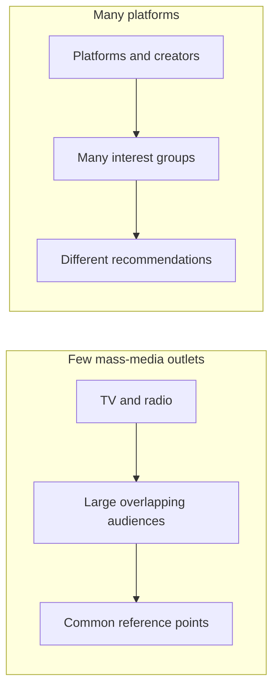

# The Video Game Crash of 1983

**Video Games in History and Society**  
**Speaking of bursting bubbles...**  
**60 minutes.** Could the problems that crashed the video game industry in 1983 happen again today?

This is the teaching sequence for the lab, aligned to the supplied 20-slide outline. It is a guide, not a generated PowerPoint deck. The website keeps the original bilingual template and uses nine lesson pages plus the reward arcade. Written answers are optional for progression; final submission shows counts by page. Display Atari controls on the board.

## 0–10 minutes: Welcome to 1983

1. **Do Now.** Students imagine saving $30, approximately $100 in 2026 using the Minneapolis Fed's estimated CPI. Show Fire Fly, Super Breakout, and Karate. Ask the two pre-play questions, let students confirm one choice, play briefly, and write the expectation/reality reflection. The one-game choice survives refresh.
2. **How did you decide?** Ask students what evidence they actually had. Draw out reliance on box art without requiring the same judgment of every game.
3. **How do we choose today?** Collect friends, gameplay videos, streamers, reviews, and social media as research options. Ask how that differs from the early 1980s. Do not imply magazines, advertisements, arcade experience, and friends did not exist then.

## 10–22 minutes: Too many games

4. **Monoculture vs. fragmentation.** Teacher discussion only; no lab question. Sketch a few broadcast outlets feeding large, overlapping audiences, next to many platforms feeding smaller, overlapping interest groups. These are simplified media patterns, not claims that everyone watched the same programs or that everyone now lives in isolation. Ask how common reference points and word of mouth affect a product's reputation.

5. **The Atari 2600.** Introduced in 1977 with nine launch titles. Compare nine launch games with the eventual library of hundreds; do not represent the eventual count as a count for 1983. Explain third-party publishing.
6. **Are all Atari games bad?** The good-game section contains Yars’ Revenge, River Raid, H.E.R.O., Pitfall!, and Star Wars: The Arcade Game. Have students briefly sample one or two to keep time. These comparisons look across the console's life, including later releases; they are not all purchases available in 1983. Ask what made the experience enjoyable. Keep the comparison about design rather than simply graphics.
7. **The problem with choice.** With hundreds of options and limited information, how do buyers avoid disappointment? Let brand recognition emerge as a plausible strategy.

## 22–30 minutes: Can you trust a brand?

8. **Maybe buy something familiar.** The choices are Spider-Man, Superman, and Ghostbusters. The brand purchase has its own saved choice. Treat this as an Atari retrospective: Ghostbusters is a post-crash example, not something available to the imaginary buyer in 1983. Its player has a Finish Shopping control mapped to Javatari's F4 function.
9. **A famous name.** Did recognizing a franchise increase confidence? Was that confidence justified by actual play? Explain branding and licensing. Students may disagree about quality when they support their judgments.

## 30–40 minutes: E.T. and the crash

10. **E.T.** Ask who has seen it. Show a short teacher-selected clip or trailer. Connect the film's cultural prominence to shared media references.
11. **Christmas morning, 1982.** Students imagine unwrapping the game they begged for, then try it. Was it worth the wait? This is a flashback from the Do Now's 1983 scenario.
12. **What happened?** Warshaw had roughly five weeks to build the game. Discuss reception and unsold inventory. Show a teacher-selected landfill clip: burial in 1983, excavation in 2014. More than E.T. was buried.
13. **WHY?** Open The crash page. It contains the question without leading hints. Wait in silence. Let students formulate and explain the connections.
14. **Reveal the factors.** After discussion, use Continue after our discussion and enter the pacing code (`cheesestick` by default). The website reveals oversaturation, overproduction, quality, limited information, financial risk, confidence, and home-computer competition. Emphasize multiple causes and the North American scope.

Use the password at the end of each page listed in PASSWORDS.md. Centipede opens the separate explanation page and locks earlier games across refresh; answers remain available.

## 40–55 minutes: Is history repeating itself?

15. **Everything is fine, right?** Rapidly discuss GTA VI's blockbuster expectations, discoverability on Steam, Roblox copies, and Fortnite's cosmetics/variants. These are different practices. The page makes no current price or release-date claims.
16. **AI slop.** Ask how cheaper, faster production could affect discovery and trust. Separate AI use, repetition, poor quality, and deception. Ask for evidence rather than visual guesses.
17. **Roblox discussion, 10–12 minutes.** Students supply examples. Ask which experiences feel like copies, how they choose what is worth playing, and whether/how AI changes discovery. Use vetted images or projected examples. The page provides optional notes for the three prompts.
18. **1983 vs. 2026.** Use the comparison table. Could the industry crash again for similar reasons? Accept either position with reasoning and evidence; do not equate abundant digital games with an inevitable repetition of the physical-cartridge crash.

## 55–60 minutes: Exit and reward

19. **Exit ticket.** It is 2026; you have $100. How would you choose a game? How does the decision differ from the one you made in 1983? Use one lesson idea. Students review completion counts, add name/class, and submit directly to the teacher's Google Sheet once connected.
20. **The arcade reopens.** The final freeplay password opens the arcade page. Its 23 reward/comparison games appear first, then a divider, then all seven games from the other lesson pages. All 30 have local cover art and can be freely chosen here. The original crash lock remains in place on earlier lesson pages.

## Before teaching

- Tell students which comparison games to sample so the five choices do not consume the discussion time.
- Add approved E.T. movie and landfill clips. Their URLs are intentionally not invented.
- Add Ghostbusters cover art when supplied; the title card is usable meanwhile.
- Connect the response Sheet using SETUP-GOOGLE-SHEETS.md. We can do the account setup together in the next session.
- Test from a student device on the school network.
